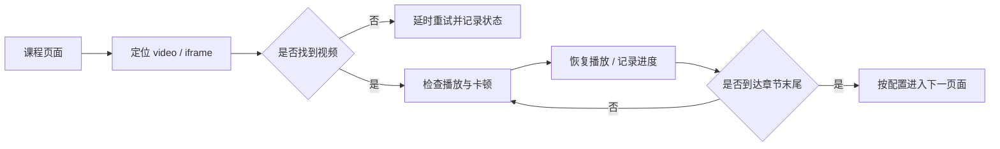

<p align="center">
  
</p>

<h1 align="center">学习页面播放助手</h1>

<p align="center">
  学习通页面视频状态检测、播放辅助与问题诊断脚本的整理版。
</p>

<p align="center">
  
  
  
</p>

## 说明

这个仓库把本地积累的多版用户脚本、诊断工具和链接记录整理为可查找的原型归档。主版本保留基础的视频元素定位、播放状态检查、卡顿判断与页面切换逻辑，课程地址改为显式配置。

本项目只用于个人学习、页面兼容性研究与无障碍播放实验。请遵守学校规定和学习平台服务条款；项目不提供代学、代考、成绩伪造或绕过课程要求的能力。

## 已做的整理

- 删去重复的 `- 副本` 文件，只保留有版本差异的脚本。
- 把课程地址集中到主脚本的 `VIDEO_URLS` 配置区。
- 将个人课程 ID、`enc`、`cpi`、`openc`、认证参数等统一替换为 `REDACTED` 或占位符。
- 原始页面快照、课程资料和个人排障记录不会进入 Git，避免把账号状态、课程结构或个人数据带入版本历史。
- 将调试脚本与历史版本分目录存放。

## 快速开始

1. 安装 Tampermonkey。
2. 打开 [`src/study-playback.user.js`](src/study-playback.user.js)。
3. 在 `VIDEO_URLS` 数组中填入你有权访问的课程页面地址。
4. 在 Tampermonkey 中新建脚本并粘贴内容，或通过“实用工具”导入本地 `.user.js`。
5. 打开学习页面，使用脚本右侧面板启动或停止。

```javascript
var VIDEO_URLS = [
    "https://mooc1.chaoxing.com/mycourse/studentstudy?chapterId=YOUR_CHAPTER_ID&courseId=YOUR_COURSE_ID&clazzid=YOUR_CLASS_ID&cpi=YOUR_CPI&enc=YOUR_ENC"
];
```

建议先在单个无敏感信息的测试页面验证，再用于日常使用。

## 工作方式



## 目录

```text
xxt-study-playback/
├── src/
│   └── study-playback.user.js       # 当前主版本
├── diagnostics/                     # iframe、目录、章节与导航诊断
├── archive/                         # v13、早期版本、课程 2 与多课程原型
├── config/urls.example.txt          # 配置模板
└── docs/banner.svg
```

## 配置项

主脚本开头的 `CFG` 包含播放节奏、暂停区间、切页延迟、卡顿阈值等参数。页面结构变化时，优先运行 `diagnostics/` 下的只读诊断脚本定位问题，再修改选择器。

## 隐私

原始文件夹中的课程链接包含个人访问参数。上传版已将这些参数脱敏；如果后续维护时新增真实链接，请使用本地未跟踪副本，并在提交前运行安全检查：

```powershell
./scripts/check-secrets.ps1
```

## 状态

这是一个个人实验原型，不是承诺长期兼容学习平台改版的正式产品。平台页面结构变化后，脚本可能需要重新诊断和调整。

